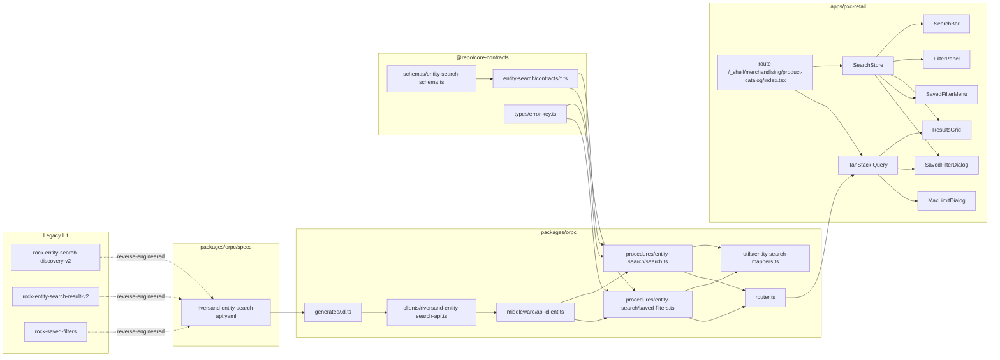
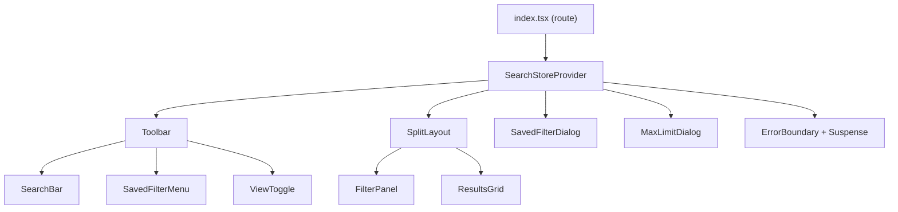

# React Rewrite: Product Catalog Search (RPC-21)

> **Status**: Stage 3 (Design) — companion to [`docs/adr-RPC-21-product-catalog-search.md`](./adr-RPC-21-product-catalog-search.md). Stage 4 development picks up the file impact list from the ADR.

## Source Repository

> **At the start of any session working on this rewrite, ask the user for the path to the `ui-platform-business-components-v2` checkout.**

Key Lit files (read at least once before changing anything):

- `<root>/src/elements/rock-entity-search-discovery-v2/rock-entity-search-discovery-v2.js` — 1,749 LOC. Top-level orchestrator: search bar, filter panel, saved-filter toolbar, max-limit popup, edit-mode dialog, query-string assembly.
- `<root>/src/elements/rock-entity-search-result-v2/rock-entity-search-result-v2.js` — 6,246 LOC. Owns the grid request (`request.params.query.filters` carrying `keywordsCriterion` / `attributesCriterion` / `typesCriterion`), the response → grid transform via `DataTransformHelper.transformEntitiesToGridFormat`, selection, sort, paging, view-mode toggle.
- `<root>/src/elements/rock-saved-filters/rock-saved-filters.js` — saved-filter CRUD + favorites + shared-with-role/all semantics; all calls land on `/data/pass-through/configurationservice/*`.
- `<root>/src/elements/rock-saved-filter-card/` — one row in the saved-filter list (re-implemented as `SavedFilterCard` in the React tree).
- `<root>/src/elements/rock-search-filter-v2/` — facet panel (tag picker, attribute popover, classification tree). Source for the React `FilterPanel` design.
- `<root>/src/helpers/SearchHelper.js` (1,126 LOC) — pure helpers for assembling filter tags and saved-search payloads. Useful as a transform reference; **not ported** verbatim — we re-derive the few helpers we need as TypeScript pure functions colocated with the feature.
- `<root>/src/helpers/DataRequestHelper.js` (4,284 LOC) — generic request envelope assembly. Only used here as a reference; the BFF builds the envelope via openapi-fetch.

## Target Location

This rewrite lives in `apps/pxc-retail` (with BFF support in `@syndigo/orpc` and contracts in `@repo/core-contracts`). Co-located app code, no separate publishable package.

```
apps/pxc-retail/src/features/product-catalog-search/
  store/
    SearchStore.ts            createSearchStore() + SearchStoreContext
    updaters.ts               pure updater functions (test target)
    updaters.test.ts
    url-sync.ts               searchParamsFromStore / storeFromSearchParams
  components/
    SearchBar.tsx             keyword input + active-facet chips
    FilterPanel.tsx           collapsible facet groups
    ResultsGrid.tsx           table + virtualization
    SavedFilterMenu.tsx       toolbar dropdown
    SavedFilterDialog.tsx     CRUD modal
    MaxLimitDialog.tsx        renders on entity_search.saved_filter_limit_reached
  hooks/
    useSearchResults.ts       useSuspenseQuery wrapper
    useSavedFilters.ts        list + create/update/delete mutations
  __tests__/
    *.test.tsx                Vitest + Testing-Library
```

Imports use the `#/` alias: `import { SearchBar } from '#/features/product-catalog-search/components/SearchBar'`. UI primitives come from `@syndigo/design-system/components/*`. Cross-package contracts come from `@repo/core-contracts/*` and `@syndigo/orpc`.

---

## 1. Overview

The product catalog search page is the highest-traffic surface in the legacy Riversand UI. It currently lives at `apps/pxc-retail/src/routes/_shell/merchandising/product-catalog/index.tsx` as a placeholder POC link page. This rewrite replaces that placeholder with a full React implementation of `rock-entity-search-discovery-v2` (the 1,749-line Lit orchestrator) plus its grid (`rock-entity-search-result-v2`) and saved-filter sub-tree (`rock-saved-filters`).

The migration follows the proven contract-first pattern established by `attributeManager` and `relationshipManager`:

1. A new OpenAPI spec at `packages/orpc/specs/riversand-entity-search-api.yaml` describes the upstream Riversand pass-through surface.
2. `openapi-typescript` generates `packages/orpc/src/generated/riversand-entity-search-api.d.ts`.
3. `openapi-fetch` produces a typed client at `packages/orpc/src/clients/riversand-entity-search-api.ts`.
4. The `api-client.ts` middleware injects `context.entitySearchApi` alongside the existing `context.attributeApi` and `context.api`.
5. `packages/orpc/src/procedures/entity-search/*.ts` map raw Riversand shapes to normalized types via `entity-search-mappers.ts`.
6. `@repo/core-contracts/src/entity-search/contracts/*.ts` wraps Zod schemas with `ErrorKey`-typed errors.
7. The React feature reads via `useSuspenseQuery(orpc.entitySearch.search.queryOptions(...))` and writes via `useMutation(orpc.entitySearch.savedFilters.create.mutationOptions())`.

The `$productId` detail page (the Attributes + Assets + Relationships POC at `apps/pxc-retail/src/routes/_shell/merchandising/product-catalog/$productId.tsx`) is **untouched**. Search links to it via row click; the detail page itself is owned by the prior migration tickets.

---

## 2. Goals & Non-Goals

### Goals

- Functional parity with the Lit orchestrator for the common path: keyword search, faceted filter, paging, sort, row click into the detail page.
- Saved-filter CRUD: list, create, rename, delete, duplicate, apply, share-with (`_SELF` / `_ROLE` / `_ALL`).
- Deep-link / refresh stability: opening a URL with `?q=...&facets=...&page=...&savedFilterId=...` restores the exact view.
- Permission gates wired correctly at both the route (`requireModuleAccess('product-catalog', 'read')`) and procedure (`requirePermission('product-catalog', 'read|write')`) layers.
- All user-facing strings flow through i18n with `t($ => $.path)` selector callbacks; six new `entity_search.*` error keys with matching `errors.entity_search.*` translations in en/es/fr/de.
- TanStack Store slice-subscription pattern (mirrors `relationship-manager`) to bound re-renders on the wide grid.
- The new `riversand-entity-search-api.yaml` spec is reverse-engineered, complete enough to generate types for every field the procedures touch, and stays free of `passthrough()` so drift surfaces as a compile-time or Zod parse error rather than silent corruption.

### Non-Goals (explicitly deferred — already captured under "Out of Scope" in the ADR)

- Stubbed auth replacement (R1) — separate ticket; RPC-21 is allowed to ship to `dev` only.
- The `$productId` detail page — untouched.
- Yaml ratification with the platform-API team — the yaml is a Stage 3/4 reverse-engineered starting point; ratification is a separate process owned by R3.
- Column-layout persistence (`rock-grid-config` / per-user column visibility) — follow-up ticket.
- Configure-column / advanced grid options dialogs — out.
- Bulk download / bulk export actions — selection state is shipped, but the download orchestration is out.
- Variant model / classification tree navigation — separate entity-hierarchy migration.
- `/health` endpoint (R4) — separate ticket.
- AI suggestion highlighting inside results — none of the Lit code paths we ship in RPC-21 invoke it.

---

## 3. Architecture Overview



Trust zones:

- Browser → BFF: untrusted; the only privilege flows from the session cookie pinned by the platform shell (currently stubbed; R1 carrier).
- BFF → Riversand: **trusted**; the pass-through layer attaches the tenant/user headers from `AuthedContext`. The browser never sees a Riversand URL or token.
- The grid never receives raw Riversand entity shapes — every response goes through `entity-search-mappers.ts` before crossing the procedure boundary.

---

## 4. API Layer

### 4.a Upstream Riversand surface (reverse-engineered)

Every upstream HTTP call observed in the Lit source is enumerated below. Every field the Lit code actually reads is captured; everything else is intentionally **not** modeled (drift surface — surfaces as a Zod parse error if Riversand starts returning it).

All endpoints are HTTP POST. Base path `/data/pass-through/{service}/{action}`. Identified services for this slice: `entityservice`, `configurationservice`. (Govern, validate, AI, model, match services exist in the upstream catalog but are not consumed by the search surface in RPC-21.)

#### 4.a.1 — `POST /data/pass-through/entityservice/get` (search)

Source: `rock-entity-search-result-v2.js` lines 2396 / 2720–2876, `rock-entity-search-discovery-v2.js` `_populateQueryString` / `_parseAndExecuteQuery`. Query envelope built by `QueryBuilderManager.buildQuery` and threaded through `request.params.query.filters` on the grid datasource.

Request body:

```ts
{
  params: {
    query: {
      // Optional — caller can ask for specific ids inline (cf. _entityDataGetReq)
      ids?: string[],
      filters: {
        typesCriterion?: string[],        // entity-type list ("sku", "product", …)
        attributesCriterion?: Array<       // facet selections; ANDed by default
          Record<string, {                  //   key = attribute name
            eq?: string,                     //   prefix-wildcard search
            exact?: string,                  //   quoted exact-match
            in?: string[],                   //   multi-value match (observed in tag.value)
          }>
        >,
        isAttributesCriterionOR?: boolean, // when true, attributesCriterion is OR'd
        keywordsCriterion?: {               // free-text search
          [field: string]: unknown,          //   typically { fields: ['_ALL'], keyword: 'foo' }
        },
        relationshipsCriterion?: Array<unknown>,  // not consumed in RPC-21
        and?: Array<unknown>,               // _entityDataGetReq adds keyword via .and.push
      },
      contexts?: Array<Record<string, string>>,   // tenant / role / user context
      valueContexts?: Array<{                    // locale/source/channel per value
        locale: string, source: string, channel?: string
      }>,
      sort?: {                                   // sortCriterion fed from _sortCriterion
        properties: Array<{ sortType: '_STRING' | '_NUMBER', name: '_ASC' | '_DESC' }>,
      },
    },
    fields?: {
      attributes?: string[],                     // ["_ALL"] or specific names
      relationships?: string[],                  // ["_ALL"] or specific
    },
    options?: {
      from?: number,                             // zero-indexed offset
      maxRecords?: number,                       // page size (default 25 in source)
      ALLOW_LEADING_WILDCARD?: boolean,
    },
    isCombinedQuerySearch?: boolean,             // combined govern + entity (we do NOT use)
  },
}
```

Response body (the procedure reads only the marked fields):

```ts
{
  response: {                                    // read: status, content
    status: 'success' | 'error',
    content: {
      entities: Array<{                          // read: every field below
        id: string,
        type: string,
        data: {
          attributes: Record<string, {
            values: Array<{
              source: string, locale: string,
              value: unknown,                    // string | number | boolean | object
              uom?: string | string[],
              referenceDataId?: string | string[],
            }>,
            properties?: Record<string, unknown>,
          }>,
        },
      }>,
      totalRecords?: number,                     // we expose as totalRecords
      facets?: Record<string, Array<{            // observed on faceted queries
        value: unknown, count: number, displayValue?: string,
      }>>,
    },
    statusDetail?: {                             // error envelope (E0142, E0473, etc.)
      messages: Array<{ messageCode: string, message?: string, messageParams?: unknown[] }>,
    },
  },
}
```

Error response (status `error`):

```ts
{
  response: {
    status: 'error',
    statusDetail: { messages: Array<{ messageCode: string, message?: string }> },
  },
}
```

The grid observes specific codes:

- `E0142` — too many filters; messageParams `[currentCount, maxAllowed]` → maps to `entity_search.query_invalid` with params.
- `E0473` — entity-type deletion in flight; we map to `upstream.conflict`.

#### 4.a.2 — `POST /data/pass-through/entityservice/getbyids` (refresh by id)

Source: `rock-entity-search-result-v2.js` line 5739, `rock-saved-filters.js` lines 1428, 1549. Used to (a) refresh thumbnails for a saved-filter result preview, and (b) hydrate a single row after inline action.

Request body — same shape as 4.a.1 but with `params.query.ids: string[]` always populated and no `keywordsCriterion`/`attributesCriterion` at the top level.

Response body — identical to 4.a.1.

#### 4.a.3 — `POST /data/pass-through/configurationservice/get` (saved filters: list my searches)

Source: `rock-saved-filters.js` lines 2201–2222 (my searches) and 2241–2266 (favorites mapping).

Request body:

```ts
{
  params: {
    query: {
      contexts: Array<{
        app: string,                   // 'search-<domain>'
        component: 'rock-saved-filters',
        domain?: string,
        entityType?: string,
        tenant?: string,
        role?: string,
        user?: string,                 // for "my searches" — userContext.user
        createdUser?: string,          // alternate filter
      }>,
      filters: {
        typesCriterion: ['savedSearch'] | ['searchMappings'],  // 'savedSearch' for list, 'searchMappings' for favorites
      },
    },
    sort?: {                           // _ASC by _STRING name
      properties: Array<{ sortType: '_STRING', name: '_ASC' }>,
    },
    options: {
      maxRecords: number,              // default 50 (the configured max)
      getnearestPath?: string,         // 'app>>component>>domain>>entityType>>tenant>>role>>user' for shared
      getnearestReturnAll?: boolean,
      includeRequest?: boolean,
    },
  },
}
```

Response body:

```ts
{
  response: {
    status: 'success' | 'error',
    configObjects: Array<{                 // savedSearch config objects
      id: string,                          // saved-filter id (Riversand-generated, stable)
      name: string,                        // 'savedsearch_<slug>_<rand>'
      data: {
        contexts: Array<{
          context: {
            app: string, component: string, domain?: string,
            entityType?: string, tenant: string,
            role?: string, user?: string, createdUser?: string,
          },
          jsonData: {
            config: {
              name: string,                // user-facing name
              searchid?: string,           // sometimes a separate id (see _updateDataManuallyWithoutGetCall)
              searchname?: string,
              accesstype: '_SELF' | '_ROLE' | '_ALL',
              role?: string,
              dimensions?: unknown,
              displayQuery?: string,
              internalQuery: string,       // the serialized facet query — primary payload
              governData?: unknown,
              workflowData?: unknown,
              dependencyData?: unknown,
              nestedAttributesWithSameRowFilter?: unknown,
              domain?: string,
              createdby?: string,          // 'username_user' shape
              isFavourite?: boolean,
            },
          },
        }>,
      },
    }>,
  },
}
```

The procedure normalizes this into `SavedFilter[]` — see 4.d for the normalized shape.

#### 4.a.4 — `POST /data/pass-through/configurationservice/getnearest` (saved filters: shared with role/all)

Source: `rock-saved-filters.js` lines 2133–2160. Same request body as 4.a.3 but with `params.options.getnearestPath` set and `maxRecords` doubled. Same response shape.

The two queries (`get` for "my searches" + `getnearest` for "shared") are merged at the procedure layer; the BFF returns one normalized list flagged with `scope: 'mine' | 'shared'`.

#### 4.a.5 — `POST /data/pass-through/configurationservice/create` (saved filters: create)

Source: `rock-saved-filters.js` lines 627–635, 1827–1860 (`generateSaveRequest('create', …)`).

Request body:

```ts
{
  configObjects: Array<{                      // single element for create
    name: string,                             // 'savedsearch_<slug>_<rand>'
    type: 'savedSearch',
    data: {
      contexts: Array<{
        context: {
          app: string, component: 'rock-saved-filters',
          domain: string, tenant: string,
          role: string,                        // '_DEFAULT' for _ALL, user's role otherwise
          user: string,                        // '_DEFAULT' for shared, user's id for _SELF
          createdUser: string,                 // always user's id
        },
        jsonData: {
          config: {                            // same shape as 4.a.3 read side
            name: string, accesstype: '_SELF' | '_ROLE' | '_ALL',
            role?: string, displayQuery?: string, internalQuery: string,
            governData?: unknown, workflowData?: unknown,
            dependencyData?: unknown, dimensions?: unknown,
            nestedAttributesWithSameRowFilter?: unknown,
          },
        },
      }>,
    },
  }>,
  hotline?: boolean,                          // observed but not load-bearing for create
}
```

Response body:

```ts
{
  response: {
    status: 'success' | 'error',
    configObjects?: Array<{ id: string, name: string, /* echo of request */ }>,
    statusDetail?: { messages: Array<{ messageCode: string, message?: string }> },
  },
  // The Lit code also pokes at request.originalRequestData.configObjects for the
  // optimistic update, which our React tree mirrors with TanStack Query setQueryData.
}
```

#### 4.a.6 — `POST /data/pass-through/configurationservice/update` (saved filters: update / rename / re-share)

Same request body as `create` but each `configObjects[i]` carries an existing `id`. The Lit code preserves `data.contexts[0].jsonData.config.searchid` and mutates `name`, `accesstype`, `role`, `internalQuery`, etc. (See `_setSearchDetailsForUpdate` and `_updateReqObjCxtInfo`, lines 674–720.)

#### 4.a.7 — `POST /data/pass-through/configurationservice/delete` (saved filters: delete)

Source: `rock-saved-filters.js` lines 725–735 (`_onTapSavedSearchDelete`).

Request body:

```ts
{
  configObjects: Array<{
    id: string,                  // saved-filter id from list response
    type: 'savedSearch',
  }>,
  hotline?: boolean,             // observed = true for delete
}
```

Response body — `{ response: { status: 'success' | 'error', statusDetail?: ... } }`.

#### 4.a.8 — Headers + multi-tenancy

The platform shell pins:

- `X-RDP-Tenant-Id: <tenantId>` (BFF reads this from `AuthedContext.tenantId`)
- `X-RDP-User-Id: <userId>`
- `Content-Type: application/json`
- Session cookie pinned by RDP edge (stubbed in dev — R1).

These flow through `apiClientMiddleware` (`packages/orpc/src/middleware/api-client.ts`) which spreads `headers` into the openapi-fetch client config; no procedure code touches them directly.

### 4.b Yaml-first chain


Regeneration command (added in Stage 4):

```bash
pnpm --filter=@syndigo/orpc generate:entity-search-api
```

Runs automatically before `build` and `typecheck` via the existing Turbo pipeline (mirrors `generate:attribute-api`).

### 4.c YAML sketch (delivered as `packages/orpc/specs/riversand-entity-search-api.yaml.draft`)

See the companion file `packages/orpc/specs/riversand-entity-search-api.yaml.draft`. It declares OpenAPI 3.1, models all of 4.a.1–4.a.7, and includes example requests/responses. Story RPC-22 promotes it from `.draft` to the real `.yaml` after a refinement pass.

The draft purposefully **avoids** OpenAPI `additionalProperties: true` on every leaf; only `Record<string, AttributeSearchValue>`-style places use `additionalProperties` with an explicit `$ref`. This keeps the generated Zod (via the conversion step in Stage 4) free of `passthrough()`.

### 4.d oRPC procedure surface

| Procedure | Input schema | Output schema | Error codes (declared) | Permission | Mapper |
|---|---|---|---|---|---|
| `entitySearch.search` | `SearchInputSchema` (`keyword?`, `facets?`, `entityTypes?`, `sort?`, `page`, `pageSize`, `valueContexts`) | `SearchResultSchema` (`entities`, `totalRecords`, `facets`) | `BAD_REQUEST`, `UNAUTHORIZED`, `FORBIDDEN`, `NOT_FOUND`, `CONFLICT`, `UNPROCESSABLE_CONTENT`, `TOO_MANY_REQUESTS`, `TIMEOUT`, `INTERNAL_SERVER_ERROR` | `requirePermission('product-catalog', 'read')` | `mapEntityListFromApi` |
| `entitySearch.getById` | `{ ids: string[], valueContexts }` | `{ entities: Entity[] }` | as above | `requirePermission('product-catalog', 'read')` | `mapEntityListFromApi` |
| `entitySearch.savedFilters.list` | `{ scope?: 'mine' \| 'shared' \| 'all' }` | `{ savedFilters: SavedFilter[] }` | as above | `requirePermission('product-catalog', 'read')` | `mapSavedFilterFromApi` |
| `entitySearch.savedFilters.create` | `SavedFilterCreateInputSchema` (`name`, `internalQuery`, `sharedWith`, `displayQuery?`, `domain?`) | `{ savedFilter: SavedFilter }` | + `CONFLICT` for name collision, `PAYLOAD_TOO_LARGE` for max-50 | `requirePermission('product-catalog', 'write')` | `mapSavedFilterFromApi` |
| `entitySearch.savedFilters.update` | `SavedFilterUpdateInputSchema` (`id`, `name?`, `internalQuery?`, `sharedWith?`) | `{ savedFilter: SavedFilter }` | as above | `requirePermission('product-catalog', 'write')` | `mapSavedFilterFromApi` |
| `entitySearch.savedFilters.delete` | `{ id: string }` | `{ id: string }` | as above | `requirePermission('product-catalog', 'write')` | `mapSavedFilterFromApi` |

The `search` procedure also exposes `metaErrorMap` that turns specific upstream `messageCode` values into typed `errorKey`s:

| Upstream messageCode | `errorKey` | HTTP code |
|---|---|---|
| `E0142` (too many filters) | `entity_search.query_invalid` | `BAD_REQUEST` |
| `E0473` (entity-type delete in-flight) | `upstream.conflict` | `CONFLICT` |
| anything else with `response.status === 'error'` | `upstream.bad_request` | `BAD_REQUEST` |
| HTTP 504 | `upstream.timeout` | `TIMEOUT` |
| HTTP 401/403 | `upstream.unauthorized` / `upstream.forbidden` | preserved |
| Mapper throws (unknown facet shape) | `entity_search.upstream_drift` | `INTERNAL_SERVER_ERROR` |

The `savedFilters.create` procedure detects the 50-limit pre-flight by calling `savedFilters.list({ scope: 'mine' })` first; if the count is already at the configured max it throws `entity_search.saved_filter_limit_reached` (HTTP `UNPROCESSABLE_CONTENT`). This is a deliberate Stage 3 design choice — the upstream service does not enforce the count, the Lit UI did (`_isSavedSearchMaxCountReached`).

---

## 5. State Management

### 5.a TanStack Store shape

```typescript
import { Store, useStore } from '@tanstack/store'
import type {
  Entity,
  SavedFilter,
  Facet,
  ValueContext,
} from '@repo/core-contracts/types/entity-search'

export type FacetKey = string   // e.g. 'brand', 'color', 'taxonomy_path'
export type FacetValue = {
  value: string                  // wire value (preserves original case for the eq filter)
  displayValue?: string          // localized label (when known)
}

export type SearchFilters = {
  keyword: string                              // free-text input (debounced 300ms before commit)
  facets: Record<FacetKey, FacetValue[]>       // selected values per facet, ANDed across keys
  entityTypes: string[]                        // typesCriterion projection
  sort?: { field: string, direction: 'asc' | 'desc' }
}

export type SearchState = {
  // Committed query — what's actually being fetched
  filters: SearchFilters

  // Pending edit — what the user is staging in the filter panel before Apply
  pendingFilterEdit: SearchFilters | null

  // Paging
  page: number          // zero-indexed
  pageSize: number      // default 25

  // Saved-filter wiring
  savedFilterId: string | null      // when set, search is "owned" by a saved filter
  savedFilters: SavedFilter[]       // mirrored from useSavedFilters query (read-only mirror)
  showSavedFilterDialog: boolean
  showMaxLimitDialog: boolean

  // Selection (checkbox column for future bulk actions)
  selection: Record<string, true>   // entity id → present iff selected

  // Display
  viewMode: 'grid' | 'tile'

  // Localization context (used to feed valueContexts in the upstream request)
  valueContexts: ValueContext[]
}

export const createSearchStore = (initial: Partial<SearchState> = {}) =>
  new Store<SearchState>({
    filters: { keyword: '', facets: {}, entityTypes: [], sort: undefined },
    pendingFilterEdit: null,
    page: 0,
    pageSize: 25,
    savedFilterId: null,
    savedFilters: [],
    showSavedFilterDialog: false,
    showMaxLimitDialog: false,
    selection: {},
    viewMode: 'grid',
    valueContexts: [{ locale: 'en-US', source: 'internal', channel: 'web' }],
    ...initial,
  })

export type SearchStore = ReturnType<typeof createSearchStore>
```

`isLoading` is owned by TanStack Query, not the store. `totalRecords`, `facets` (server-emitted facet buckets), and the `entities` array are all derived from the query result — never copied into the store.

### 5.b Updater functions (pure; unit-tested)

All updaters live in `store/updaters.ts`. Each takes `store: SearchStore` as the first arg and uses `store.setState(s => ...)`. They are pure functions (no React, no async). One-line semantic for each:

| Name | Signature | Semantic |
|---|---|---|
| `setKeyword` | `(store, keyword: string) => void` | Commit a new keyword and reset to page 0. |
| `stageFacet` | `(store, key: FacetKey, values: FacetValue[]) => void` | Stage into `pendingFilterEdit` without firing a query. |
| `applyPendingFilterEdit` | `(store) => void` | Promote `pendingFilterEdit` → `filters`, reset page, clear pending. |
| `cancelPendingFilterEdit` | `(store) => void` | Drop `pendingFilterEdit` back to null. |
| `clearFacet` | `(store, key: FacetKey) => void` | Remove one facet key from committed filters; reset page. |
| `clearAllFacets` | `(store) => void` | Reset `filters.facets` to `{}` and page to 0. |
| `setEntityTypes` | `(store, types: string[]) => void` | Replace `entityTypes` (drives typesCriterion). |
| `setPage` | `(store, page: number) => void` | Set page; bounded by caller. |
| `setPageSize` | `(store, n: number) => void` | Set page size; resets page to 0. |
| `setSort` | `(store, sort: SearchFilters['sort']) => void` | Update sort; resets page to 0. |
| `applySavedFilter` | `(store, sf: SavedFilter) => void` | Replace `filters` from `sf.parsedQuery`; record `savedFilterId = sf.id`; reset page; clear selection. |
| `clearSavedFilter` | `(store) => void` | Null `savedFilterId` without changing filters (user kept editing). |
| `setSavedFilters` | `(store, list: SavedFilter[]) => void` | Mirror query result into the store for synchronous reads. |
| `openSavedFilterDialog` | `(store) => void` | Set `showSavedFilterDialog = true`. |
| `closeSavedFilterDialog` | `(store) => void` | Set `showSavedFilterDialog = false`. |
| `openMaxLimitDialog` | `(store) => void` | Set `showMaxLimitDialog = true`. Called from mutation `onError` when errorKey === `entity_search.saved_filter_limit_reached`. |
| `closeMaxLimitDialog` | `(store) => void` | Set `showMaxLimitDialog = false`. |
| `toggleSelection` | `(store, entityId: string) => void` | Flip a single row's selection. |
| `setSelectionAll` | `(store, entityIds: string[]) => void` | Replace selection with the provided set. |
| `clearSelection` | `(store) => void` | Wipe selection. |
| `setViewMode` | `(store, mode: 'grid' \| 'tile') => void` | Toggle layout. |

Test target (Stage 4, RPC-23): one file `updaters.test.ts` with at least one test per updater (mirrors `relationship-manager/store/updaters.test.ts` and its 13-test floor; we'll aim for ≥20 here).

### 5.c URL ↔ Store sync (`store/url-sync.ts`)

Two pure functions:

```ts
// URL → store input
export function storeFromSearchParams(p: ProductCatalogSearchParams): Partial<SearchState>

// Store → URL output
export function searchParamsFromStore(s: SearchState): ProductCatalogSearchParams
```

`ProductCatalogSearchParams` is the Zod-parsed route search schema:

```ts
const productCatalogSearchSchema = z.object({
  q: z.string().optional(),                    // keyword
  facets: z.string().optional(),               // base64-encoded JSON Record<string, string[]>
  entityTypes: z.array(z.string()).optional(),
  sort: z.string().optional(),                 // 'field:asc' / 'field:desc'
  page: z.number().int().nonnegative().default(0),
  pageSize: z.number().int().positive().max(200).default(25),
  savedFilterId: z.string().optional(),
})
```

What lives in the URL:

- `keyword`, `entityTypes`, `sort`, `page`, `pageSize`, `savedFilterId`, and a base64-encoded compact `facets` payload.

What lives **only** in the store (deliberately not URL-state):

- `pendingFilterEdit` (transient pre-Apply state)
- `selection` (refresh-resetting checkbox set)
- `showSavedFilterDialog`, `showMaxLimitDialog`
- `viewMode` (per-session display preference; future ticket may move to user prefs)
- `savedFilters` (server-owned list)

The route does **not** debounce navigation. Keystrokes commit only locally; we navigate the URL on `Apply Filters`, `Enter` in the keyword input, sort change, page change, or `Apply Saved Filter`. This avoids the Option-C critique from the ADR (every keystroke = route navigation).

### 5.d TanStack Query usage

| Query | queryKey | Suspense? | Stale time | Invalidation triggers |
|---|---|---|---|---|
| `useSearchResults()` | `orpc.entitySearch.search.queryKey({ input: derivedFromStore })` | yes | 30 s | filters / sort / page / pageSize / savedFilterId changes (queryKey changes naturally) |
| `useSavedFilters()` | `orpc.entitySearch.savedFilters.list.queryKey({ input: { scope: 'all' } })` | no (non-blocking — the dialog opens fast) | 60 s | invalidated after `create` / `update` / `delete` mutation success |

Mutations:

- `orpc.entitySearch.savedFilters.create.mutationOptions()` — on success invalidates the list and applies the new saved filter via `applySavedFilter`; on error with `errorKey === 'entity_search.saved_filter_limit_reached'`, calls `openMaxLimitDialog` and suppresses the default toast via `meta: { errorToast: false }`.
- `orpc.entitySearch.savedFilters.update.mutationOptions()` — invalidates list; toast confirms via `meta: { successKey: $ => $.entitySearch.saved_filter_updated }` (Stage 4 will add the wrapper, the project doesn't have a `successKey` meta yet — see Open Question 7).
- `orpc.entitySearch.savedFilters.delete.mutationOptions()` — invalidates list; clears `savedFilterId` if the deleted id matches.

The route loader prefetches the first page so SSR renders rows immediately:

```ts
loader: ({ context: { queryClient }, search }) => {
  queryClient.ensureQueryData(
    orpc.entitySearch.search.queryOptions({
      input: deriveSearchInput(search),
    }),
  )
}
```

---

## 6. Component Tree



| Component | Owned slice (subscriptions) | Key props | Internal state |
|---|---|---|---|
| `SearchBar` | `filters.keyword` | `onCommit(keyword: string)` | local controlled input + `useDebouncedCallback(300ms)`; commit on Enter / blur / debounce settle |
| `FilterPanel` | `pendingFilterEdit ?? filters`, `entityTypes` | `onApply`, `onClear` | collapse-state per group (local); facet-group async data via secondary query (Stage 4) |
| `ResultsGrid` | `selection`, `viewMode`, `page`, `pageSize` | reads results via `useSearchResults()` (suspense) | row virtualization via `@tanstack/react-virtual` when `entities.length > 100` |
| `SavedFilterMenu` | `savedFilters`, `savedFilterId` | `onApply(sf)`, `onOpenDialog` | toolbar dropdown using `@base-ui/react` Combobox; trigger label = current saved filter name |
| `SavedFilterDialog` | `showSavedFilterDialog`, `savedFilters`, `savedFilterId` | none | modal CRUD (list + rename/duplicate/delete/share-with selector); uses `useSavedFilters()` mutations |
| `MaxLimitDialog` | `showMaxLimitDialog` | none | informational dialog; reads max from `entity_search.saved_filter_limit_reached` params |

Virtualization threshold: `entities.length > 100`. Below that, render the table without virtualization to keep keyboard nav simple. (`relationship-manager` uses the same threshold for its grid — established repo pattern.)

---

## 7. Route & Permissions

The route file `apps/pxc-retail/src/routes/_shell/merchandising/product-catalog/index.tsx` is replaced (its placeholder POC content is dropped). The signature:

```ts
export const Route = createFileRoute('/_shell/merchandising/product-catalog/')({
  validateSearch: productCatalogSearchSchema.parse,
  beforeLoad: ({ context }) => {
    requireModuleAccess(context.permissions, 'product-catalog', 'read')
  },
  loader: ({ context, search }) => {
    context.queryClient.ensureQueryData(
      orpc.entitySearch.search.queryOptions({
        input: deriveSearchInput(search),
      }),
    )
  },
  component: ProductCatalogSearchPage,
})
```

`requireModuleAccess(context.permissions, 'product-catalog', 'read')` redirects unauthorized users to `/no-access`. The route guard is the route-level gate; the BFF re-enforces via `requirePermission('product-catalog', 'read')` on every procedure (defense in depth — the BFF must never trust the route).

`$productId` is **not modified**. The grid's row click navigates to it via:

```tsx
<Link to="/_shell/merchandising/product-catalog/$productId" params={{ productId: row.id }} />
```

---

## 8. Error Handling

### 8.a New `ErrorKey` literals (added to `@repo/core-contracts/src/types/error-key.ts`)

1. `entity_search.query_invalid` — upstream rejected the assembled query (e.g. E0142 too many filters). Params: `{ currentCount?: number, maxAllowed?: number }`.
2. `entity_search.facet_unknown` — mapper saw an unknown facet shape. Params: `{ facetKey: string }`. Indicates spec drift; should also raise an OTel alert.
3. `entity_search.saved_filter_not_found` — `update` / `delete` / `apply` referenced a missing saved filter. Params: `{ id: string }`.
4. `entity_search.saved_filter_limit_reached` — create call rejected because the user has 50 saved filters. Params: `{ max: number }` (defaults to 50). Drives `MaxLimitDialog`.
5. `entity_search.saved_filter_name_taken` — duplicate name on create / rename. Params: `{ name: string }`.
6. `entity_search.upstream_drift` — mapper or Zod schema rejected a field. Params: `{ field?: string }`. Logged with the upstream raw payload (trimmed) on the BFF; surfaces as a generic error toast on the client.

### 8.b Translation keys plan

Added to `apps/pxc-retail/src/locales/{en,es,fr,de}/translation.ts` under `errors.entity_search.*`:

```ts
errors: {
  entity_search: {
    query_invalid: 'The search has too many filters ({{currentCount, number}} of {{maxAllowed, number}} allowed).',
    facet_unknown: 'Unrecognized filter "{{facetKey}}". Try clearing filters and retrying.',
    saved_filter_not_found: 'That saved filter no longer exists.',
    saved_filter_limit_reached: 'You\'ve reached the maximum of {{max, number}} saved filters. Delete one to save another.',
    saved_filter_name_taken: 'A saved filter named "{{name}}" already exists.',
    upstream_drift: 'The search service returned an unexpected response. Please contact support.',
  },
}
```

Each locale file gets the same key set with translated values. `i18n-sync` skill validates the four files match at the end of RPC-22 / RPC-26.

UI strings (not error strings) — placeholders, "No results", facet group labels, dialog titles, toolbar button text, etc. — are also added under `productCatalog.search.*`. Exact key list locked in Stage 4 once the JSX is written (the ADR doesn't enumerate them and we shouldn't pre-commit to names that may not survive component review).

### 8.c i18next depth-limit mitigation (R5)

Recorded in `feedback_i18next_depth_limit.md` (user memory): adding too many interpolated nested keys can trip TS2589 in existing `t()` selector callbacks. The risk surface here:

- Six new `errors.entity_search.*` keys, four with parameter interpolation.
- An estimated 20-30 new UI strings under `productCatalog.search.*` (final count locked in Stage 4).

Predicted hot spots:

1. The `errors.entity_search.query_invalid` selector touches `currentCount` + `maxAllowed` number formatters — two-arg interpolated selectors are the highest-risk shape.
2. Any place we use `dynamicSelector(\`errors.${errorKey}\`)` (already present in `error-toast.ts`).

Mitigation tier 1: keep new keys at a single level of nesting under `errors.entity_search.*` (already planned).

Mitigation tier 2: if TS2589 reappears in Stage 4, fall back to a flat shape (`errors.entity_search_query_invalid` etc.) and a `Record<EntitySearchErrorKey, TranslationSelector>` lookup table. The `error-key` skill will keep the BFF type + locale files in sync atomically either way.

Mitigation tier 3 (escape hatch): a `const tt = t as unknown as <K extends string>(key: K, params?: object) => string` cast at the SavedFilterDialog call site if a specific selector won't type-check. Only used as last resort; explicitly flagged for review.

---

## 9. Security & Multi-Tenancy

Trust zones:

- **Browser → BFF**: untrusted. The BFF is the only trust boundary the React tree can cross. The `RPCLink` over HTTP uses the same origin and inherits the session cookie pinned by the platform shell.
- **BFF → Riversand**: trusted. `apiClientMiddleware` constructs the openapi-fetch client with the request's `apiBaseUrl` and `headers`; these headers include the tenant + user pass-through set by `getOrpcContext`. The BFF never echoes Riversand URLs or tokens back to the browser.

Multi-tenancy propagation:

- `AuthedContext.tenantId` originates from the subdomain → `context.tenantId` mapping in `getOrpcContext` (`apps/pxc-retail/src/integrations/orpc/get-orpc-context.ts`).
- `authMiddleware` resolves `permissions` from `tenantId` × `roles` and stores them on the context.
- `requirePermission('product-catalog', 'read')` reads `context.permissions` only.
- Every procedure call into Riversand inherits the `apiBaseUrl` + `headers` from the request context — there is **no global** Riversand client cached across requests.

Saved-filter scoping:

- `_SELF` filters: stored with `context.user = <userId>`. Visible only to that user (the BFF reads `configurationservice/get` with the user's own context).
- `_ROLE` filters: stored with `context.user = '_DEFAULT'` and `context.role = <role>`. Visible to anyone in the same role (the BFF reads `configurationservice/getnearest` with the user's role).
- `_ALL` filters: `context.user = '_DEFAULT'` and `context.role = '_DEFAULT'`. Visible to everyone in the tenant.

The procedure never widens scope on the server side — it constructs the upstream context strictly from the input `sharedWith` value and the user's current `AuthedContext`. There is no path that would let user A read user B's `_SELF` saved filter.

Logging: OTel spans get `app.tenant_id` + `enduser.id` from `spanAttributesMiddleware`. The mapper writes `upstream.entity_search.message_code` on error spans so support can pivot from an ErrorKey → upstream root cause.

---

## 10. Compliance Matrix

| Standard | Description | Decision | Status |
|---|---|---|---|
| **S-001.2** | Pipeline quality gates — coverage threshold | Dev tier (Bronze): 60% line coverage on changed feature dir. Repo has no CI yet (R2 carrier), so we'll enforce **locally** via Vitest's `--coverage` flag run as part of the PR template checklist. | Compliant (manual gate; R2 carrier) |
| **S-001.7** | Test evidence traceability | PR template requires Vitest output for `apps/pxc-retail` + `@syndigo/orpc` pasted into the PR description. Stage 7 (Test) will audit. | Compliant (manual; promote when CI lands) |
| **S-009.4** | Definition of Done — ACs per story | Each child story (RPC-22..RPC-26) has explicit ACs from Stage 1; design doc references the same. | Compliant |
| **S-011.1** | Code review quality | Stage 8.A triage applies — minimum 1 reviewer who is not the author; security-sensitive changes (auth, permissions) require a second reviewer. | Compliant (manual policy) |
| **S-014.x** *(TBD — exact ID unknown for "data classification on logs")* | OTel attributes must not log raw end-user input | Mapper logs only `upstream.entity_search.message_code` and the trimmed first-100-chars of the raw response on drift; **never** the raw keyword or facet payload (PII risk). | Compliant — added to design |
| **S-?? *(TBD)*** | Secrets management for upstream tokens | No new secret added by this work; all Riversand credentials remain in the platform shell and flow as headers. | Compliant — no new secrets |
| **S-?? *(TBD)*** | i18n coverage for user-facing strings | All strings flow through `t($ => ...)`; `i18n-sync` skill validates en/es/fr/de parity. | Compliant |

`requires_human_review`: **true** for the two `TBD` rows above — the design author does not have the exact Syndigo standard IDs for "OTel data classification" and "secrets management" and is asking the Stage 4 reviewer to confirm those IDs before merge.

---

## 11. Risk Assessment

Risks R1..R8 are inherited from the ADR; mitigations refined for the design layer below.

| ID | Risk | Implementation-specific mitigation |
|---|---|---|
| **R1** | Stubbed auth middleware blocks promotion past dev | Every new procedure declares `requirePermission('product-catalog', 'read|write')`. When R1 lands, the gates become effective automatically — no procedure code changes needed. Branch policy: ADR + design doc explicitly disallow merging past dev until R1 closes. |
| **R2** | No CI safety net | Stage 4 PR template requires pasted output of `pnpm lint`, `pnpm typecheck`, `pnpm test --filter=pxc-retail`, `pnpm test --filter=@syndigo/orpc` for every PR. Stage 6 work item (CI Pipeline) tracked separately. |
| **R3** | Reverse-engineered yaml introduces drift | (a) The yaml draft avoids OpenAPI `additionalProperties: true` on every leaf; only `Record<string, AttributeSearchValue>`-style places use `additionalProperties` with an explicit `$ref`, so the Zod chain does **not** use `.passthrough()`. (b) Mapper throws `entity_search.upstream_drift` on unknown shape — observable in OTel + surfaced to support via the trace ID. (c) Stage 8 promotion to `qa` gated on a one-page yaml diff review with the platform-API team. |
| **R4** | No `/health` endpoint | Out of scope. Search availability is determined by 5xx rates on the procedure span; SRE dashboard work belongs to the `/observe` workflow, not RPC-21. |
| **R5** | i18next depth limit | Six new keys are introduced under a single `errors.entity_search.*` namespace. `i18n-sync` skill runs at the end of RPC-22 and RPC-26. Fallback to a flat key shape if TS2589 reappears. See §8.c for the three-tier mitigation plan. |
| **R6** | Nitro nightly on the SSR path | This feature uses the same SSR code path as every other route. No Nitro-specific work added; risk inherited, not amplified. |
| **R7** | AKS EOL on cxh-qa-kube-01 | Deployment target unchanged; no infra moves. `tfc_workspaces_needed: []` from Stage 1 still holds. |
| **R8** | 1,749-line Lit source → behavior parity risk | (a) The `ux-reference-implementation` skill against the Loveable submodule provides the visual reference. (b) Stage 7 deep-QA explicitly walks the verification list from the ADR (12 scenarios) before merge. (c) Column-layout persistence, AI suggestions, classification-tree nav, configure-column, and bulk download are **explicitly deferred** in §2 so they don't quietly slip into parity assessment. |

---

## 12. Testing Plan

Scope by layer (Vitest 3 + Testing-Library; no Playwright in this ticket):

| Layer | What's tested | How |
|---|---|---|
| **Updaters** (`store/updaters.test.ts`) | All ~21 updater functions — pure-function unit tests, no React, no async. Includes saved-filter limit detection, page-reset semantics, pending-edit lifecycle, selection toggling. | Vitest only. Mirrors `relationship-manager/store/updaters.test.ts`. Target: 100% of updater code. |
| **URL sync** (`store/url-sync.test.ts`) | Round-trip `searchParamsFromStore` → `storeFromSearchParams` for representative state shapes, including base64 facets encoding/decoding edge cases (empty / single-key / multi-value). | Vitest. |
| **Procedure tests** (`packages/orpc/src/__tests__/entity-search.test.ts`) | All 6 procedures with MSW-mocked upstream. Happy path + each declared error code path. Drift case asserts `entity_search.upstream_drift`. | MSW + Vitest. Mirrors `relationship-manager.test.ts`. Target: every procedure has at least one happy-path test + one error-mapping test. |
| **Component shells** (`__tests__/SearchBar.test.tsx`, `FilterPanel.test.tsx`, `ResultsGrid.test.tsx`, `SavedFilterMenu.test.tsx`, `SavedFilterDialog.test.tsx`, `MaxLimitDialog.test.tsx`) | Debounce timing on SearchBar, chip add/remove on FilterPanel, empty/loading/error states on ResultsGrid, dialog open/close on the menu, CRUD round-trip on SavedFilterDialog (with mocked mutations), text rendering on MaxLimitDialog. | Testing-Library + Vitest. |
| **Route guard** | `requireModuleAccess` redirect happens when permissions don't include `product-catalog:read`. | Vitest with a fake `context.permissions` Set. |

Coverage target for `apps/pxc-retail/src/features/product-catalog-search/`: **≥70% line / ≥60% branch** measured locally (`pnpm test --filter=pxc-retail -- --coverage`). The relationship-manager dir sits at 78% line today — same bar applies here.

**Explicitly not covered** in this ticket:

- Playwright / browser-driven flows. Surface area is too large for the four sprint days the ticket has; deferred to a follow-up E2E ticket.
- Performance benchmarks. Stage 7's responsibility, not Stage 4's.
- Accessibility audit (`axe-core` run on the page). Tracked separately under the platform-wide a11y push.

---

## 13. Open Questions for Stage 4

Stage 3 could not resolve these from code alone; each becomes a spike task on RPC-22 (or its immediate successor) in Stage 4.

1. **Saved-filter ID stability** — `rock-saved-filters.js` uses both `id` and `searchid` (lines 648, 1878, 1888) and the response shape carries them at different nesting levels. Does Riversand return a stable id we can safely use as the `SavedFilter.id`, or do we need to surface both and pick `searchid` from `data.contexts[0].jsonData.config.searchid`? Confirm by inspecting a real dev response.
2. **Saved-filter name uniqueness scope** — is the 50-filter limit per-user, per-role, or per-tenant? Lit code (`_isSavedSearchMaxCountReached`) reads `_maxSavedSearches` from settings but the upstream count semantics are unclear. Affects the pre-flight count in `savedFilters.create`.
3. **`internalQuery` serialization format** — the Lit code stores the query as a freeform string built by `QueryBuilderManager.buildQuery`. Do we (a) preserve that exact string format for cross-Lit-and-React-app interop, or (b) define our own JSON-serialized facets payload? Recommendation: preserve the Lit string format on write so a saved filter created in Lit can be applied in React (and vice versa). Validate by saving a filter in Lit dev, reading it in React dev.
4. **Facet response shape** — `data.content.facets` is observed but not consistently populated in the source samples. Are facet buckets returned automatically, or do we need to add a `facetFields` parameter to the request? Affects the FilterPanel data-loading strategy.
5. **`E0142` filter-count limit** — what is the actual `maxAllowedFiltersForSearch` value Riversand enforces? The Lit code reads it from the error response itself. Useful to surface in the UI proactively (e.g. disable Apply when staged facets exceed the limit).
6. **Configuration-service tenancy** — does `configurationservice/{create,update,delete}` accept the same tenant header pass-through as `entityservice`, or does it require an additional context? Verify by hitting dev.
7. **`successKey` mutation meta** — the repo's `MutationCache.onError` reads `meta.errorToast`; there is no `meta.successKey` today. We need success toasts for saved-filter CRUD ("Saved filter created", "Renamed", "Deleted"). Stage 4 decides: add a `successCache` wrapper, or call `toast.success(t($ => ...))` inside the mutation `onSuccess` callback. Recommendation: per-component success toast for now; promote to a global cache if the pattern repeats elsewhere.
8. **MSW handler shape for `searchandget`** — the `searchandget` action observed in `rock-saved-filters.js` line 573 is a Riversand-specific aggregation. Does our reverse-engineered yaml need to model it, or can we treat the `configurationservice/get` GET-then-search pattern as the single call? Recommendation in this draft: omit `searchandget` from the yaml until we observe the BFF needing it; the Lit code uses it for an optimization (name-collision pre-flight) we can do server-side in `savedFilters.create`.

---

## Verification (Stage 7 will execute this list)

1. Hit the route — list renders entities; URL has default params.
2. Type in the SearchBar, press Enter — URL updates with `?q=...`, results re-fetch, page resets to 0.
3. Open the FilterPanel, stage two facet selections, click Apply — `pendingFilterEdit` clears, `filters.facets` updates, query fires.
4. Cancel pending edits before Apply — `pendingFilterEdit` clears, no query fires.
5. Apply a saved filter from the menu — `filters` replaces from the saved-filter `internalQuery`, `savedFilterId` records the id, URL updates.
6. Create a new saved filter from the current view — success toast; menu refreshes; new filter is selectable.
7. Create the 51st saved filter — `MaxLimitDialog` renders; toast is suppressed.
8. Rename a saved filter — list reflects the new name; `savedFilterId` unchanged if it was selected.
9. Delete the currently-applied saved filter — list updates; `savedFilterId` becomes null; `filters` keep the prior state (user can save again).
10. Click a row — navigates to `$productId` detail page.
11. Refresh the page on a deep-linked URL — exact same view restores (all URL params honored).
12. Switch user to one without `product-catalog:read` — route guard redirects to `/no-access`.
13. Permission server-side — call `entitySearch.search` without the permission → BFF returns `FORBIDDEN`, client renders `RouteErrorComponent` access-denied state.
14. Force a mapper drift (test fixture with unknown facet shape) → procedure emits `entity_search.upstream_drift`; trace ID is in the toast.

---

## Implementation Order (Stage 4 cadence — matches RPC-22..RPC-26)

1. **RPC-22** — yaml ratified (drop `.draft` suffix), generated types, openapi-fetch client, middleware injection, mappers, contracts, six error keys, search + getById procedures, MSW procedure tests.
2. **RPC-23** — route scaffold, search-params schema, SearchStore + updaters + URL-sync + tests, SearchBar, ResultsGrid.
3. **RPC-24** — FilterPanel with collapsible groups + facet data loading.
4. **RPC-25** — saved-filter contracts + procedures + dialog + menu + MaxLimitDialog.
5. **RPC-26** — nav swap (verify `PackageSearch` icon in `navigation-config.ts`), full i18n sweep across en/es/fr/de, error-key sync, component shell tests, coverage verification.
