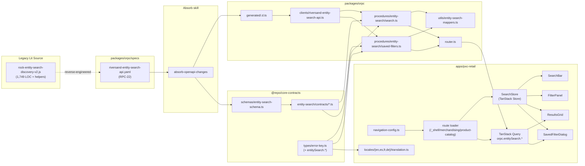

# ADR: RPC-21 — Product Catalog Search (Lit → TanStack/oRPC Migration)

## Status

**Proposed** — Stage 2 (Planning). Approval gate before Stage 4 development.

## Date

2026-05-14

## Ticket

- Epic: [RPC-21](https://syndigo.atlassian.net/browse/RPC-21) — *Re-implement product catalog search page (Lit -> TanStack/oRPC migration)*
- Stories:
  - [RPC-22](https://syndigo.atlassian.net/browse/RPC-22) — Reverse-engineer Riversand search API into yaml, derive contracts
  - [RPC-23](https://syndigo.atlassian.net/browse/RPC-23) — Search UI scaffold (route + SearchBar + ResultsGrid)
  - [RPC-24](https://syndigo.atlassian.net/browse/RPC-24) — Filter panel + faceted criteria
  - [RPC-25](https://syndigo.atlassian.net/browse/RPC-25) — Saved filters (CRUD + deep-link restoration)
  - [RPC-26](https://syndigo.atlassian.net/browse/RPC-26) — Nav swap, i18n, error keys, tests, coverage

## Context

The product catalog search page is the single highest-traffic surface in the legacy Riversand UI. It is currently implemented as a 1,749-line LitElement web component (`rock-entity-search-discovery-v2`, plus a ~1,200-line `rock-entity-search-result-v2` grid and the shared `SearchHelper` / `DataRequestHelper` helpers) inside the `ui-platform-business-components-v2` monorepo. The component:

1. Issues an `entityservice/get` query with `keywordsCriterion` (free text), `attributesCriterion` (per-attribute facets), `typesCriterion`, and `relationshipsCriterion`, paged via `from` / `maxRecords`.
2. Renders the result set as either a grid or tile view with selectable rows.
3. Exposes a side filter panel (`rock-search-filter-v2`) with type, attribute, classification, taxonomy, and saved-filter facets.
4. Loads, lists, edits, duplicates, and deletes "saved filters" (`rock-saved-filters` element + supporting CRUD).
5. Wires every interaction through the global ACI event bus, `DialogManager`, and the RUF mixin stack — none of which exist in `pxc-retail`.

We have already migrated two LitElement features into the React stack:

- [docs/attribute-manager-rewrite.md](./attribute-manager-rewrite.md) — `rock-attribute-*` family (≈12,820 source LOC) using `useReducer + Context`, TanStack Query, custom `AttributeBindingProvider`.
- [docs/relationship-manager-rewrite.md](./relationship-manager-rewrite.md) — `rock-relationship-*` family (≈12,548 source LOC) using **TanStack Store** + context, TanStack Query, normalized Zod schemas.

Both migrations established a yaml-first contract pattern: `packages/orpc/specs/riversand-*.yaml` is the source of truth; `openapi-fetch` generates the upstream client; Zod schemas live in `@repo/core-contracts/src/schemas/`; oRPC contracts wrap them with `ErrorKey`-typed errors; procedures map raw Riversand shapes to normalized types via `*-mappers.ts`; the React feature reads via `useSuspenseQuery(orpc.<domain>.<method>.queryOptions(...))`. The `absorb-openapi-changes` skill keeps the chain in sync.

Why now: RPC-21 is the next slice of the Lit → TanStack migration; the catalog search page must ship before the broader merchandising shell can flip default-on for tenants. The existing `$productId` detail-page POC (Attributes + Assets + Relationships) is downstream of search — until search lands, users have no path to a product.

**Constraints carried from Stage 1:**

- Cannot promote past **dev** until the stubbed auth middleware (`packages/orpc/src/middleware/auth.ts`) is replaced with real RDP session-cookie pass-through (Stage 8 gate, R1).
- The `entity-search` API surface is *under* the `product-catalog` permission module — no new module is added.
- New `ErrorKey` literals must add `errors.<key>` to en/es/fr/de in the same commit (R5).
- Local-only pre-merge gating (no CI safety net — R2).
- The yaml in RPC-22 is **reverse-engineered**, not contract-ratified by the API team; we mitigate (R3) by colocating with the existing attribute yaml so both can be re-ratified together.

## Options Considered

### Option A — Mirror `attribute-manager`: `useReducer + Context` + TanStack Query

State for filters / selection / saved-filter CRUD lives in a single React Context fed by a typed `useReducer`. TanStack Query owns the data: list query keyed by `(keyword, facets, page, sort)`, mutation hooks for save / delete / rename.

| Pros | Cons |
|---|---|
| Direct fit with the most-recent and most-tested pattern in the repo (`AttributeManageContext` — 32 reducer unit tests). | Reducer churn on every keystroke; debouncing every filter change is required to avoid query thrash. |
| Reducer is easy to snapshot for "revert to saved filter" semantics. | `useReducer` re-renders all consumers of the context; filter chips, results grid, and saved-filter list all bound to the same provider would force `React.memo` walls. |
| Action types map cleanly to telemetry events. | More boilerplate vs. a pure-store approach. |

Complexity: **medium**.

### Option B — Mirror `relationship-manager`: TanStack Store + TanStack Query

Filter state, selection, saved-filter list, and active saved-filter id live in a `@tanstack/store` instance provided via a `SearchStoreContext`. Components subscribe to *slices* (`useStore(store, s => s.facets)`), so a chip-list re-rendering doesn't re-render the grid. Updaters are named functions, not actions.

| Pros | Cons |
|---|---|
| Slice subscriptions avoid the re-render fan-out problem; the grid (heavy) only re-runs when its slice changes. | Newer pattern in the repo (1 reference implementation vs. 2 for the reducer pattern); slightly steeper onboarding cost. |
| Named updaters are trivially unit-testable as pure functions (mirrors `updaters.test.ts` in relationship-manager). | Two stores in the same app (relationship + search) is fine but worth documenting. |
| URL-state ↔ store sync stays out of React render path. | Need to be careful about store identity when route changes (recreate vs. reset). |
| Saved-filter "apply" is a single `applyFilter(store, filter)` call — composes cleanly. | |

Complexity: **medium**.

### Option C — TanStack Router search params as the single source of truth + TanStack Query only

Use the route's `search: z.object({...}).parse()` as the entire filter state; no extra store. Saved filters serialize/deserialize to/from search params. TanStack Query keys read from `useSearch()`.

| Pros | Cons |
|---|---|
| Deep-linkable / refresh-stable by construction; no URL ↔ state sync code. | Saved-filter CRUD is *not* URL state — still need a store or query cache for that. |
| Zero local state for the filter panel. | Every keystroke is a route navigation → renders the entire `_shell` subtree; mitigated only by debouncing on the controlled input. |
| Smallest surface to test. | Selection set (checked rows for bulk action) is not URL-state — would need a side store anyway. |
| | Mid-flight filter edits (chips removed/added before "Apply") need staging state — back to Option A or B. |

Complexity: **low** at first, **high** at the seams (selection, in-flight edits, mutation cache).

### Decision Matrix

| Criterion | A: Reducer | B: Store | C: Search Params |
|---|---|---|---|
| Render performance with heavy grid | weak | **strong** | medium |
| Saved-filter CRUD ergonomics | medium | **strong** | weak |
| Deep-link / refresh restoration | medium | **strong (via URL sync)** | **strong (free)** |
| Pattern continuity with prior migrations | high | high | low |
| Migration debt | none | none | high (selection store still needed) |
| Test surface | medium | **low** (pure updaters) | medium |

## Decision

**Option B — TanStack Store + TanStack Query**, with the route's `search` schema reflecting a *projection* of the store (keyword, page, sort, savedFilterId, serialized facets) for deep linking and back/forward navigation.

Rationale:

1. **Re-render fan-out** is the dominant performance concern on a search page that holds a wide table; slice subscriptions in `@tanstack/store` are the proven mitigation in `relationship-manager` and we don't want to regress.
2. **Saved-filter CRUD** is conceptually pending-state machinery (load → edit → save / cancel) — identical to the pending-changes pattern already implemented in `RelationshipManageStore.pendingChanges`. We get the exact same updater shape for free.
3. **URL sync** is decoupled: a single `useEffect` writes store → search, and the route loader hydrates store ← search on first mount. No router thrash on keystrokes; deep links and refresh still work.
4. Continuity: the next migration after this (likely entity hierarchy / classification) will also benefit from the store pattern — we extend coverage rather than fragment it.
5. **Selection** (checkboxes for bulk download / export) is already a known store slice (`relationship-manager` has `selection: Record<string, string[]>`); we copy it verbatim.

The reducer pattern (Option A) remains correct for `attribute-manager`-style features whose state is *one entity being edited*. Search is a *list with filters*, which is the relationship-manager class of problem.

### Yaml-first contract chain (per prior migrations)

```
packages/orpc/specs/riversand-entity-search-api.yaml             ← RPC-22 deliverable
       ↓  pnpm --filter=@syndigo/orpc generate:entity-search-api
packages/orpc/src/generated/riversand-entity-search-api.d.ts     ← derived TS types
       ↓
packages/orpc/src/clients/riversand-entity-search-api.ts         ← openapi-fetch client
       ↓
packages/orpc/src/middleware/api-client.ts                       ← injects context.entitySearchApi
       ↓
packages/orpc/src/procedures/entity-search/search.ts             ← raw → normalized mappers
       ↓
@repo/core-contracts/src/entity-search/contracts/search.ts       ← Zod contracts + ErrorKeys
       ↓
orpc.entitySearch.search                                         ← used in product-catalog feature
```

Module key on the procedure: `requirePermission('product-catalog', 'read')` for `search`, `requirePermission('product-catalog', 'write')` for `savedFilters.create|update|delete` (per the per-project memory note that entity-search lives **under** `product-catalog`).

## Consequences

### Positive

- One state container (TanStack Store) for both selection and saved-filter pending state; slice subscriptions keep the grid renders bounded.
- Deep linking works on first load because URL → store hydration runs in the route's `beforeLoad` / `loader`.
- Saved-filter CRUD reuses the pending-changes shape from `relationship-manager` → pure-function updaters → tiny test surface.
- The new yaml in RPC-22 increases coverage of the upstream surface, paying down R3 over time.
- Permission gates live at the procedure layer; the route guard is a thin `requireModuleAccess('product-catalog', 'read')`.

### Neutral

- Adds a second `@tanstack/store` instance type (search + relationship); both are scoped to their feature trees and never share state.
- A second openapi-fetch client (`riversand-entity-search-api.ts`) joins the existing `riversand-attribute-api.ts`; both go through the same `api-client.ts` middleware.

### Negative

- Reverse-engineered yaml introduces drift risk; **mitigated** by recording every Riversand field we observed in the Lit source as a Zod field (no `passthrough()`) and gating Stage 8 promotion on a one-page review with the platform-API team (R3).
- The full Lit feature includes "configure column" / "save column layout" semantics tied to user prefs persistence. We do **not** port column persistence in RPC-21; it is captured as a known gap and tracked separately.
- Two i18n change sets per `ErrorKey` (BFF type + 4 locale files) is unchanged by this decision but worth surfacing — `i18n-sync` plus `error-key` skill will keep it correct (R5).

## Architecture Diagram



## File Impact

| Path | Action | Story | Notes |
|---|---|---|---|
| `packages/orpc/specs/riversand-entity-search-api.yaml` | NEW | RPC-22 | OpenAPI 3.1 spec covering `entityservice/get` (search), `entityservice/getbyids` (refresh by id), saved-filter CRUD (`entityservice/create|update|delete` against the `savedSearch` entity type). Source of truth for the chain. |
| `packages/orpc/package.json` | MOD | RPC-22 | Add `generate:entity-search-api` script (mirrors `generate:attribute-api`). |
| `packages/orpc/src/generated/riversand-entity-search-api.d.ts` | NEW (generated) | RPC-22 | Output of `openapi-typescript`. Checked in alongside the spec, per current repo convention. |
| `packages/orpc/src/clients/riversand-entity-search-api.ts` | NEW | RPC-22 | `openapi-fetch` client. |
| `packages/orpc/src/middleware/api-client.ts` | MOD | RPC-22 | Inject `context.entitySearchApi` alongside existing `context.attributeApi` and `context.api`. |
| `packages/orpc/src/utils/entity-search-mappers.ts` | NEW | RPC-22 | Raw `entityservice/get` response ↔ normalized `SearchResult` / `Facet` / `SavedFilter` types. |
| `packages/orpc/src/procedures/entity-search/search.ts` | NEW | RPC-22 / RPC-23 | `search` procedure (paged) and `getById` procedure. `requirePermission('product-catalog', 'read')`. |
| `packages/orpc/src/procedures/entity-search/saved-filters.ts` | NEW | RPC-25 | `savedFilters.list|create|update|delete|rename` procedures. `read` for list; `write` for the rest. |
| `packages/orpc/src/router.ts` | MOD | RPC-22 / RPC-25 | Register `entitySearch` namespace exporting `search`, `getById`, `savedFilters.*`. |
| `packages/orpc/src/__tests__/entity-search.test.ts` | NEW | RPC-22 / RPC-25 | MSW-backed procedure tests (mirrors `relationship-manager.test.ts`). |
| `packages/core-contracts/src/schemas/entity-search-schema.ts` | NEW | RPC-22 | Zod schemas for `SearchInput`, `SearchResult`, `Facet`, `SavedFilter`, plus `KeywordsCriterion` / `AttributesCriterion` / `TypesCriterion`. |
| `packages/core-contracts/src/types/entity-search.ts` | NEW | RPC-22 | `z.infer<>` exports — canonical TS types for the domain. |
| `packages/core-contracts/src/entity-search/contracts/search.ts` | NEW | RPC-22 / RPC-23 | oRPC contracts declaring the 9 standard error codes. |
| `packages/core-contracts/src/entity-search/contracts/saved-filters.ts` | NEW | RPC-25 | CRUD contracts. |
| `packages/core-contracts/src/index.ts` | MOD | RPC-22 | Re-export the `entitySearch` contract object. |
| `packages/core-contracts/src/types/error-key.ts` | MOD | RPC-22 / RPC-25 / RPC-26 | Add `entity_search.*` literals: `entity_search.query_invalid`, `entity_search.facet_unknown`, `entity_search.saved_filter_not_found`, `entity_search.saved_filter_limit_reached`, `entity_search.saved_filter_name_taken`. |
| `apps/pxc-retail/src/locales/en/translation.ts` | MOD | RPC-26 | Add `errors.entity_search.*` keys; product-catalog UI strings (search placeholder, "No results", "Saved filter saved", facet group labels). |
| `apps/pxc-retail/src/locales/es/translation.ts` | MOD | RPC-26 | Mirror en additions. |
| `apps/pxc-retail/src/locales/fr/translation.ts` | MOD | RPC-26 | Mirror en additions. |
| `apps/pxc-retail/src/locales/de/translation.ts` | MOD | RPC-26 | Mirror en additions. |
| `apps/pxc-retail/src/routes/_shell/merchandising/product-catalog/index.tsx` | MOD | RPC-23 | Replace POC link page with the search shell — `beforeLoad: requireModuleAccess('product-catalog', 'read')`, search schema parse, route loader prefetches first page via TanStack Query. |
| `apps/pxc-retail/src/routes/_shell/merchandising/product-catalog/$productId.tsx` | **UNTOUCHED** | n/a | Existing detail-page POC. Out of scope per Stage 1 constraint. |
| `apps/pxc-retail/src/features/product-catalog-search/store/SearchStore.ts` | NEW | RPC-23 | `createSearchStore()` + `SearchStoreContext`. Holds `keyword`, `facets`, `page`, `sort`, `selection`, `savedFilterId`, `pendingFilterEdit`. |
| `apps/pxc-retail/src/features/product-catalog-search/store/updaters.ts` | NEW | RPC-23 / RPC-24 / RPC-25 | Pure-function updaters: `setKeyword`, `setFacet`, `clearFacets`, `setPage`, `setSort`, `applySavedFilter`, `startEditFilter`, `cancelFilterEdit`, `selectRow`, `clearSelection`. |
| `apps/pxc-retail/src/features/product-catalog-search/store/updaters.test.ts` | NEW | RPC-23 | Pure unit tests (mirrors relationship-manager's pattern). |
| `apps/pxc-retail/src/features/product-catalog-search/store/url-sync.ts` | NEW | RPC-23 | `searchParamsFromStore` / `storeFromSearchParams` — single source of serialization. |
| `apps/pxc-retail/src/features/product-catalog-search/components/SearchBar.tsx` | NEW | RPC-23 | Debounced text input + active-facet chips. Reads `keyword` slice; writes via `setKeyword`. |
| `apps/pxc-retail/src/features/product-catalog-search/components/FilterPanel.tsx` | NEW | RPC-24 | Collapsible facet groups (type, attribute, taxonomy). Lazy-loaded via TanStack Query. |
| `apps/pxc-retail/src/features/product-catalog-search/components/ResultsGrid.tsx` | NEW | RPC-23 | Table primitives from `@syndigo/design-system`, virtualized via `@tanstack/react-virtual` if row-count > 100; row-click navigates to `$productId`. |
| `apps/pxc-retail/src/features/product-catalog-search/components/SavedFilterDialog.tsx` | NEW | RPC-25 | Modal: list + rename + duplicate + delete + apply. |
| `apps/pxc-retail/src/features/product-catalog-search/components/SavedFilterMenu.tsx` | NEW | RPC-25 | Dropdown trigger in the toolbar showing current saved-filter name and opening the dialog. |
| `apps/pxc-retail/src/features/product-catalog-search/hooks/useSearchResults.ts` | NEW | RPC-23 | `useSuspenseQuery(orpc.entitySearch.search.queryOptions(...))` reading the store slice. |
| `apps/pxc-retail/src/features/product-catalog-search/hooks/useSavedFilters.ts` | NEW | RPC-25 | List query + create / update / delete mutations. |
| `apps/pxc-retail/src/features/product-catalog-search/__tests__/SearchBar.test.tsx` | NEW | RPC-26 | Testing-Library: debounce, chip add/remove. |
| `apps/pxc-retail/src/features/product-catalog-search/__tests__/FilterPanel.test.tsx` | NEW | RPC-26 | Group expand, facet select. |
| `apps/pxc-retail/src/features/product-catalog-search/__tests__/ResultsGrid.test.tsx` | NEW | RPC-26 | Empty state, row click, selection. |
| `apps/pxc-retail/src/features/product-catalog-search/__tests__/SavedFilterDialog.test.tsx` | NEW | RPC-26 | CRUD happy path + limit-reached error rendering. |
| `apps/pxc-retail/src/lib/navigation-config.ts` | MOD (minimal) | RPC-26 | Already routes `/merchandising/product-catalog` to module `product-catalog`. No sub-tabs needed; only verifies the `PackageSearch` icon stays. |
| `apps/pxc-retail/src/routeTree.gen.ts` | AUTOGEN | RPC-23 | Regenerated by `pnpm dev --filter=pxc-retail`. Do not hand-edit. |

## Risks & Mitigations

(All eight items from the Stage 1 register are carried forward.)

| ID | Risk | Stage 1 Status | Mitigation in this ADR |
|---|---|---|---|
| **R1** | Stubbed auth middleware in `packages/orpc/src/middleware/auth.ts` returns a mock user; cannot promote past dev | Owned / blocker | All new procedures call `requirePermission('product-catalog', 'read|write')` so they will become effective immediately when R1 lands. ADR explicitly forbids merging to `main` past dev until R1 resolves; no change to the rollback path. |
| **R2** | No CI safety net in repo — all gating is local pre-merge | Accepted | The PR template will require pasted output of `pnpm lint`, `pnpm typecheck`, `pnpm test --filter=pxc-retail`, `pnpm test --filter=@syndigo/orpc`. Stage 6 (CI Pipeline) is still pending; this ADR does not depend on its completion. |
| **R3** | The yaml in RPC-22 is reverse-engineered from Lit source, not contract-ratified | Mitigated | (a) Every observed Riversand field is mapped to a Zod field with no `passthrough()` (drift surfaces as a Zod parse error, not silent corruption). (b) Stage 8 promotion to `qa` gated on a one-page diff review with the platform-API team. (c) Mappers throw `entity_search.upstream_drift` (added to ErrorKey) so any unhandled field is observable in OTel. |
| **R4** | No `/health` endpoint exists on the BFF | Owned | Out of scope for RPC-21. Stage 6 work item; tracked separately. ADR is informational on R4. |
| **R5** | Adding many nested error keys with interpolation has tripped TS2589 (`Type instantiation is excessively deep`) before | Mitigated | The five new error keys are introduced under a single `entity_search.*` group (no per-field nesting). `i18n-sync` skill runs at the end of RPC-22 and RPC-26. If TS2589 reappears, fall back to a flat `errors.entitySearch_*` key shape. |
| **R6** | Nitro is pinned to a nightly release on the SSR path | Accepted | Search SSR uses the same code path as the rest of the app; no Nitro-specific work added. Risk inherited, not amplified. |
| **R7** | AKS Kubernetes version on `cxh-qa-kube-01` is approaching EOL | Accepted | Deployment target unchanged for this ticket; no infra moves required (`tfc_workspaces_needed: []`). |
| **R8** | The Lit source is 1,749 lines plus helpers; behavior parity risk | Mitigated | (a) Use `ux-reference-implementation` skill against the Loveable submodule where the new IA is already drawn. (b) RPC-26 owns coverage; we set a floor of 70% line / 60% branch for the `features/product-catalog-search/` directory measured locally. (c) The "configure column" / "column persistence" feature is explicitly **deferred** and listed under Out of Scope so it doesn't quietly slip into the parity assessment. |

## Out of Scope

The following are explicitly **not** part of RPC-21 and will not be modified by any of the five child stories:

1. **Auth middleware stub fix (R1)** — separate ticket; this feature is allowed to ship to `dev` only.
2. **Existing `$productId` detail-page POC** at `apps/pxc-retail/src/routes/_shell/merchandising/product-catalog/$productId.tsx` — untouched. Search will *link to* it, but the page implementation is owned by the prior migration tickets.
3. **Yaml ratification with the platform-API team** — the spec is reverse-engineered; ratification is a separate process owned by R3.
4. **Column-layout persistence** — the legacy `rock-grid-config` / per-user column visibility persistence is not migrated in this slice. Tracked as a follow-up.
5. **Configure-column / advanced grid options** dialogs — out.
6. **Bulk download / bulk export actions** — the Lit grid surfaces these; we ship selection state but no download orchestration here.
7. **Variant model / classification tree navigation** — surfaced separately under future entity-hierarchy migration.
8. **`/health` endpoint (R4)** — separate ticket.

## Skills to use during Stage 4

- **`absorb-openapi-changes`** — run after RPC-22 lands the yaml; propagates the new spec through Zod schemas, contracts, procedures, and mappers. The skill is the canonical way to keep this chain coherent.
- **`add-orpc-procedure`** — scaffold the `entitySearch.search`, `entitySearch.getById`, `entitySearch.savedFilters.*` procedures end-to-end (Zod schema → contract → implementation → error keys → locale strings → router wiring).
- **`add-route`** — scaffold the new search route with `_shell` layout, `requireModuleAccess('product-catalog', 'read')` guard, oRPC loader pattern, and i18n.
- **`add-permission-check`** — audit each procedure and route layer for the right `requirePermission('product-catalog', 'read|write')` call.
- **`error-key`** — atomic addition of the five new `entity_search.*` error keys plus matching `errors.entity_search.*` strings in all four locale files.
- **`i18n-sync`** — final sweep before each PR to catch missing/mismatched keys across en/es/fr/de.
- **`ux-reference-implementation`** — use the Loveable submodule's product-catalog search mockups as the visual reference; apply pxc-retail patterns and the real oRPC client on top.
- **`add-design-component`** *(only if needed)* — should the FilterPanel need a new combobox variant not already in `@syndigo/design-system`, this skill defines the CVA + Tailwind 4 + `@base-ui/react` conventions to follow.

## Approval

Approval recorded by merging the ADR PR to `main`. Stage 4 development on the same `feature/RPC-21-product-catalog-search` branch (or branches off it) begins after that merge.
